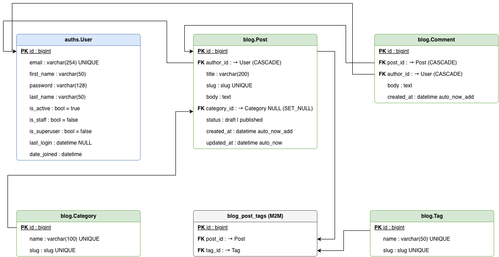
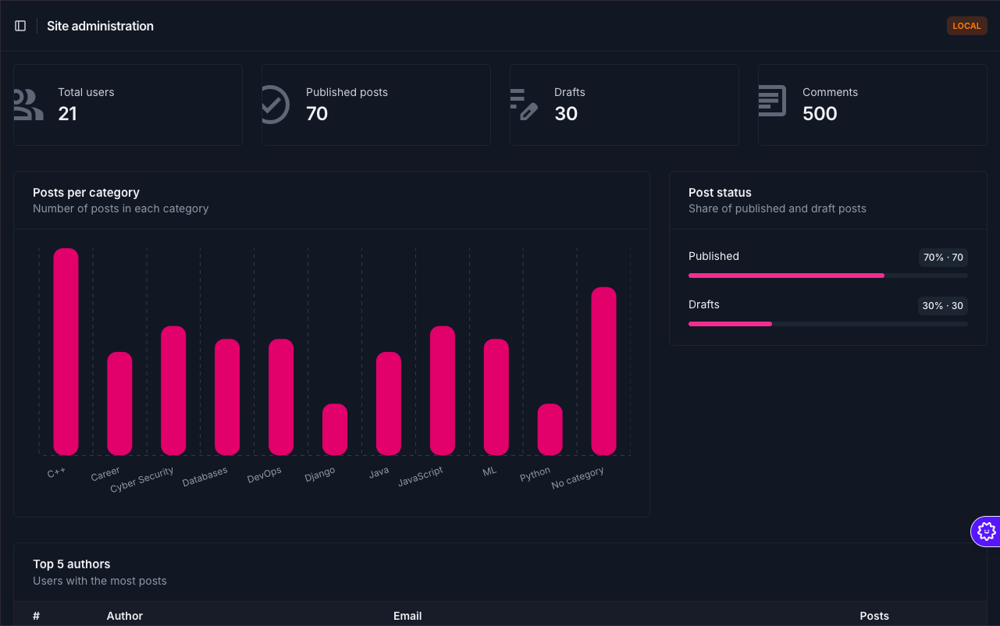
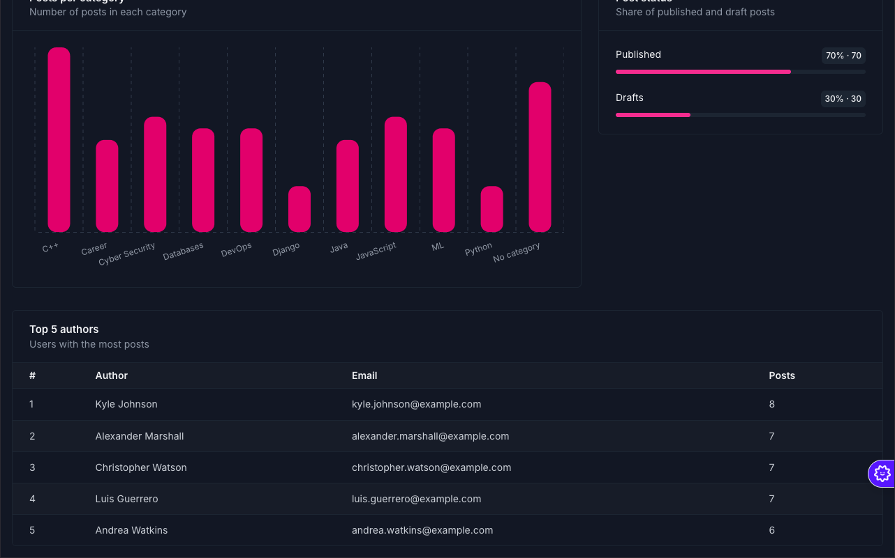
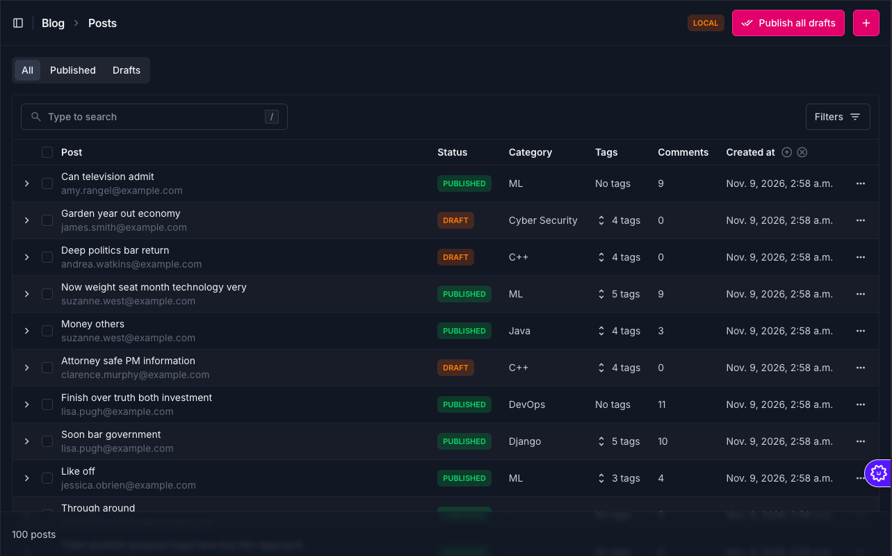
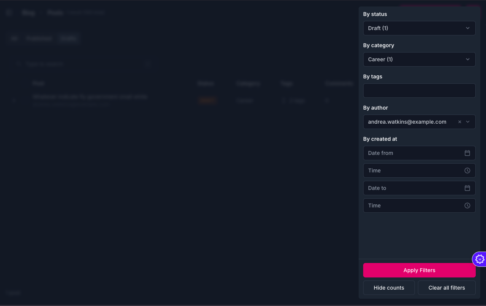
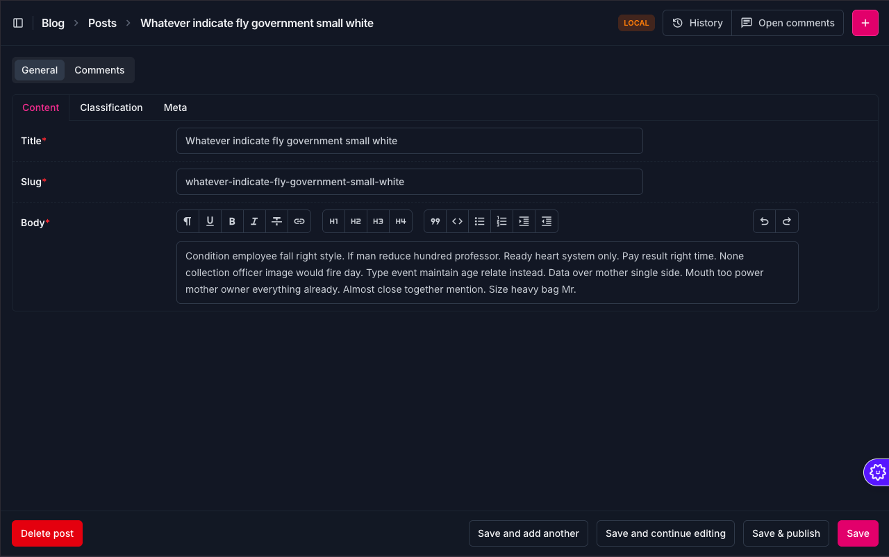
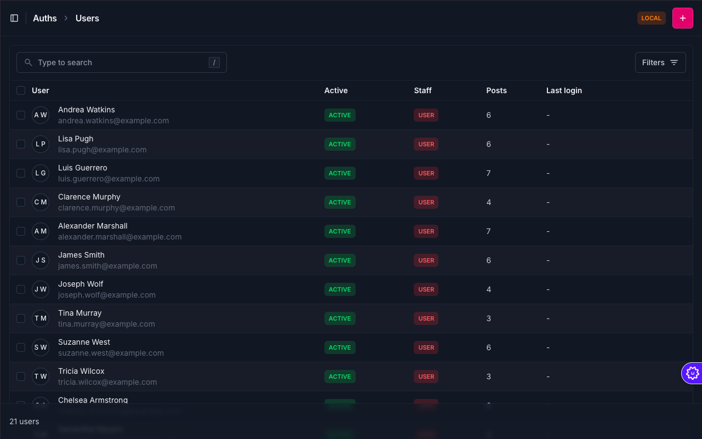
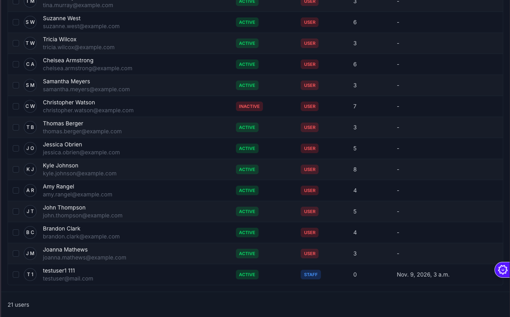
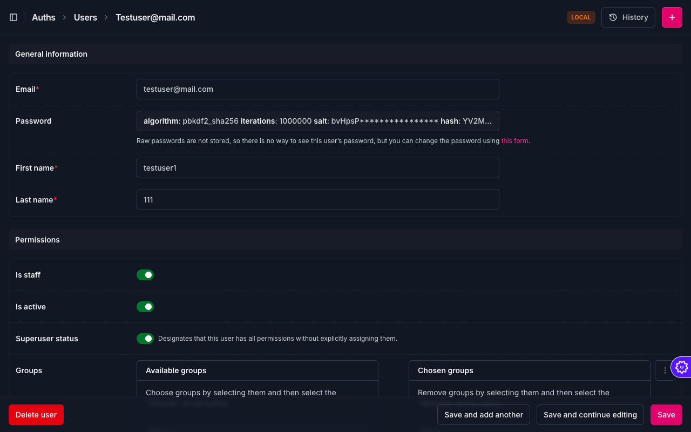

# README
## Hi! This is Zhaniya's Django project repo
This is a Django 2026 class project repository. It's a blog API with posts, comments, categories and tags. All related details will be specified here

### Project ERD


### How to run the project
1) Create a venv and install the requirements:
```bash
python3 -m venv venv
source venv/bin/activate
pip install -r requirements/dev.txt
```
2) Create the settings/.env file:
```
BLOG_ENV_ID=local
BLOG_SECRET_KEY=any-secret-key
BLOG_ALLOWED_HOSTS=localhost,127.0.0.1
```
3) Run the migrations, fill the db and create the superuser:
```bash
python3 manage.py migrate
python3 manage.py seed
python3 manage.py createsuperuser
```
4) Run the server:
```bash
python3 manage.py runserver
```

### To create the superuser:
1) Run: python3 manage.py createsuperuser
2) Then enter the required credentials for email, first/last names, password
3) Superuser created!

### To enter the admin panel:
1) Run: python3 manage.py runserver
2) go to the: http://127.0.0.1:8000/admin/
3) Enter credentials (login is by email)

## Seeding
The seed command fills the db with fake users, categories, tags, posts and comments (made with Faker).

Run:
```bash
python3 manage.py seed
```

Arguments:

| Argument     | Default | Description                         |
|--------------|---------|-------------------------------------|
| `--users`    | `20`    | Number of users to create           |
| `--posts`    | `100`   | Number of posts to create           |
| `--comments` | `500`   | Number of comments to create        |
| `--clear`    | off     | Delete existing data before seeding |

Example:
```
$ python3 manage.py seed --users 50 --posts 300 --comments 1500
Users:       50 created
Categories:  10 created
Tags:        21 created
Posts:      300 created
Comments:  1500 created
Done in 0.37 seconds
```

Some notes:
- All seeded users have the same password: SeedPass123!
- Some users are inactive and a few are staff
- About 70% of posts are published and 30% are drafts, some posts have no category, each post has 0-5 tags
- Comments are added only to published posts
- You can run seed many times, it won't create the same categories and tags again
- --clear deletes everything except superusers, so you don't lose your admin account
- If something is wrong (negative number, no users, no published posts) the command shows an error and saves nothing

## Admin
The admin panel is made with Django Unfold.

What's there:
- Pink theme, Local/Production badge and links to github and unfold docs
- Ctrl+K (Cmd+K on mac) to search everything
- Sidebar with Dashboard, Content (posts, comments, categories, tags) and Users & Access (only for superusers)
- Posts has a counter with the number of drafts

### Dashboard
Shows the number of users, published posts, drafts and comments, a chart of posts per category, top 5 authors and how many posts are published vs drafts.




### Posts
- All / Published / Drafts tabs at the top
- Status labels, tags dropdown, number of comments
- Filters by status, category, tags, author and date
- Click on the arrow in a row to see the comments of the post
- Actions: publish / move to drafts, publish or unpublish one post, publish all drafts, open comments, save & publish
- The edit page has tabs (Content, Classification, Meta), a text editor for the body and the comments in a separate tab





### Users
- Initials, name and email in one column
- Active and staff labels, number of posts
- Filters by active and staff
- Activate / deactivate selected users
- The edit page has tabs (Personal info, Permissions, Important dates), the password can be changed here too





### Comments, Categories, Tags
- Comments: search, filters by post, author and date, the post and author are picked with search
- Categories and tags: search, number of posts, the slug fills in by itself
- Click on the arrow in a category row to see its posts